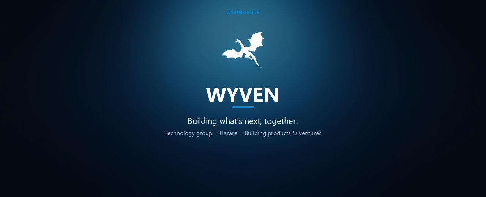

<!--
  Wyven Group — GitHub Organisation Profile
  Brand palette: #070B0F · #031D2E · #063B5C · #0A84C6 · #DCEFF8
-->

  

  <b>WYVEN GROUP</b>&nbsp;&nbsp;·&nbsp;&nbsp;Harare, Zimbabwe

 

  We build, own, operate and develop technology products and businesses. 
  Engineering capability. Product ownership. Innovation with intent.

 

---

 

<h2 align="center">What we do</h2>

  A technology group spanning intelligent systems, software, finance and platforms.

 

  <b>Artificial Intelligence</b> 
  AI-powered products, generative systems and applied research

  <b>Software &amp; Product Engineering</b> 
  Modern applications, platforms and scalable infrastructure

  <b>Financial Technology</b> 
  Digital financial infrastructure and business platforms

  <b>Enterprise Software</b> 
  Systems that simplify operations and enable growth

  <b>Digital Platforms &amp; Ventures</b> 
  Products and technology businesses we build and operate

 

---

 

<h2 align="center">Our ecosystem</h2>

  Products and ventures across health, business software and intelligence.

 

  <a href="https://www.myid.co.zw/"><b>MyID</b></a> 
  Digital health identity for emergency access, records and care

  <a href="https://about.mabhuku.com/"><b>Mabhuku</b></a> 
  Business suite for retail operations and accounting

  <b>Wyven AI</b> 
  Applied intelligence across products and platforms

 

---

 

<h2 align="center">Get involved</h2>

  Engineers, partners and organisations building what's next.

 

  Explore our repositories&nbsp;&nbsp;·&nbsp;&nbsp;
  Collaborate on products and platforms&nbsp;&nbsp;·&nbsp;&nbsp;
  Partner with the group

 

  <a href="https://wyvengroup.com"><b>Website</b></a>
  &nbsp;&nbsp;·&nbsp;&nbsp;
  <a href="https://github.com/WYV-inc"><b>GitHub</b></a>
  &nbsp;&nbsp;·&nbsp;&nbsp;
  <a href="mailto:info@wyvengroup.com"><b>Contact</b></a>

 

---

 

  

  <b>WYVEN GROUP</b> 
  Building what's next, together.

  
    <a href="https://wyvengroup.com">wyvengroup.com</a>
    &nbsp;·&nbsp;
    <a href="https://github.com/WYV-inc">github.com/WYV-inc</a>
    &nbsp;·&nbsp;
    <a href="mailto:info@wyvengroup.com">info@wyvengroup.com</a>
  

  Harare, Zimbabwe

